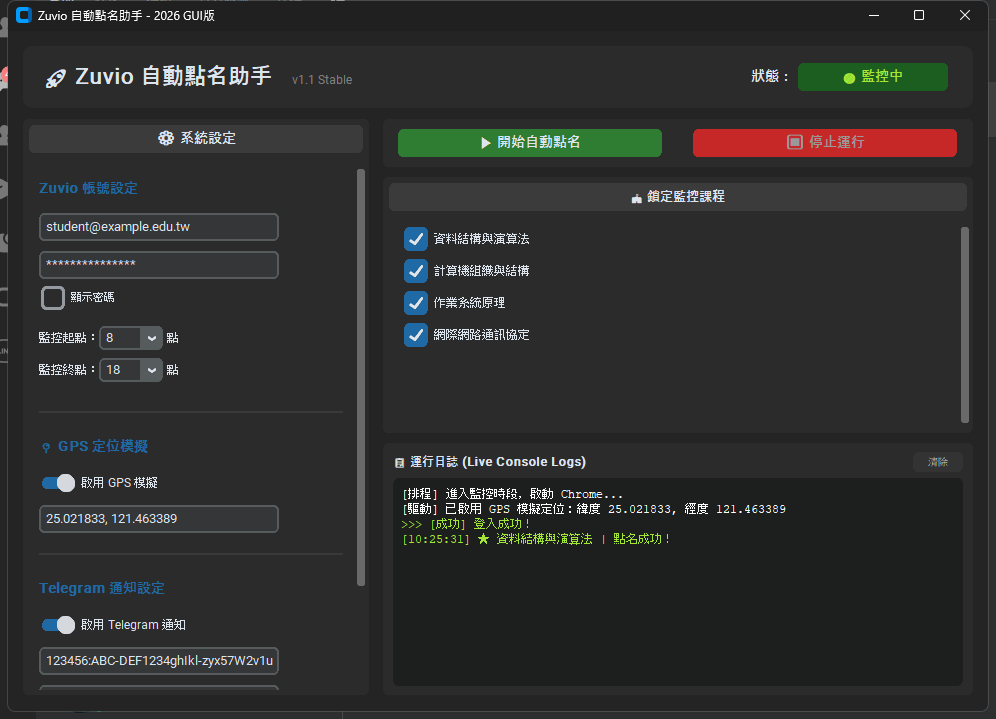

# 🚀 Zuvio Rollcall Bot (自動點名助手)

[](https://www.python.org/)
[](https://www.selenium.dev/)
[](https://github.com/TomSchimansky/CustomTkinter)
[](LICENSE)



本專案是一款專為 Zuvio 點名系統設計的自動簽到助手。支援**現代化 GUI 圖形介面**與**輕量 CLI 終端機模式**，採用多執行緒設計與強健的瀏覽器自動化技術，並支援 GPS 定位模擬與 LINE 即時通知。

---

## ✨ 核心特色與技術亮點

*   **🖥️ 雙模式啟動 (GUI / CLI)**
    *   **GUI 介面**：使用 `CustomTkinter` 打造深色主題現代化介面，提供流暢的動態狀態徽章與 Live Console 日誌渲染。
    *   **CLI 模式**：提供無頭 (Headless) 輕量運行模式，適合伺服器部署或背景自動排程。
*   **📍 CDP 地理位置模擬 (GPS Mocking)**
    *   透過 Chrome DevTools Protocol (CDP) 的 `Emulation.setGeolocationOverride` 繞過瀏覽器定位檢查。
    *   支援**十進位經緯度** (例如：`25.0218, 121.4633`) 與**度分秒 DMS** (例如：`25°01'18.6"N 121°27'48.2"E`) 雙格式自動正則解析。
*   **🏫 動態課程篩選監控**
    *   登入後自動抓取所有就讀課程，並在 GUI 畫面上渲染為核取方塊。
    *   使用者可即時剔除不需點名的課程，後端監控線程將自動同步篩選，節省網路頻寬與 CPU 資源。
*   **🔔 LINE 即時推播**
    *   整合 LINE Messaging API，**點名成功**時立即推播；**每天第一次啟動監控**時發一則確認；**持續異常**（Chrome 反覆卡住、登入一直失敗）時提醒，同類異常每小時最多一則，避免用光免費方案的每月訊息額度。
*   **🛡️ 防卡死自動復原**
    *   頁面最多載入 20 秒、與瀏覽器的每次溝通最多 60 秒；偵測到 Chrome 卡死會自動強制關閉、重開並重新登入，不會整天白跑。
*   **⚡ 線程安全與防卡死設計**
    *   將 Selenium 瀏覽器自動化與 GUI 主線程完全分離。
    *   使用 `queue.Queue` 進行線程安全的日誌與狀態更新，防止介面在執行 IO 密集任務時凍結。
*   **📦 強健的環境相容性與可攜性**
    *   **雙重驅動備份**：優先使用 Selenium 4 的 `Selenium Manager` 自動匹配本機 Chrome，失敗時降級使用 `webdriver-manager`。
    *   **動態執行路徑**：自動識別 PyInstaller 打包狀態 (`sys.frozen`)，確保設定檔 `settings.json` 與日誌一律儲存在執行檔同目錄下，支援「一鍵發送 exe」直接運行。

---

## 🛠️ 開發環境與依賴

*   **語言**: Python 3.8+
*   **主要依賴套件**:
    *   `selenium`: 瀏覽器自動化核心。
    *   `customtkinter`: GUI 框架。
    *   `webdriver_manager`: Chrome 驅動自動管理器。

### 安裝依賴

```bash
pip install -r requirements.txt
```

---

## 🚀 執行與使用方式

### 📥 快速下載與使用 (給一般使用者)

如果你不會寫程式，可以直接下載打包好的執行檔 (Windows 專用)：
1. 到 [Releases 頁面](https://github.com/Kyle1028/zuvio-rollcall-bot/releases) 下載最新的 `Zuvio.exe`。
2. 將 `Zuvio.exe` 放在一個專屬資料夾 (例如桌面新增一個 `Zuvio 自動點名` 資料夾)。
3. 直接雙擊執行 `Zuvio.exe`。
4. 在圖形介面輸入帳號密碼，設定好上課時間後，按下 **「▶ 開始自動點名」** 即可放在背景執行！
*(註：第一次執行時會自動於同目錄產生 `settings.json` 與相關日誌檔，請勿直接在壓縮檔內執行。)*

---

### 💻 從原始碼執行 (開發者模式)

#### 1. GUI 介面模式 (預設)

直接執行 `Zuvio.py`：

```bash
python Zuvio.py
```

*   **初次使用**：輸入 Zuvio 帳密與時段設定，點選「▶ 開始自動點名」會自動儲存設定並於背景啟動 Chrome。
*   **即時選取**：課程清單載入後，勾選想要監控的課程即可。

### 2. CLI 終端機模式

在終端機附加 `--cli` 參數啟動：

```bash
python Zuvio.py --cli
```

*   若無設定檔，系統會引導填寫帳密與 LINE 通知配置，隨後進入無頭瀏覽器監控循環。

### 🔔 LINE 通知設定

> LINE Notify 已於 2025/3/31 停止服務，本專案改用 **LINE Messaging API**（免費建立官方帳號即可）。

1. 到 [LINE Developers](https://developers.line.biz/) 用你的 LINE 帳號登入，建立一個 Provider，再建立 **Messaging API** channel（會順便建立一個 LINE 官方帳號）。
2. **Channel access token**：channel 的「Messaging API」分頁最下方 → Channel access token (long-lived) → **Issue**，複製下來。
3. **User ID**：channel 的「Basic settings」分頁最下方 →「**Your user ID**」（U 開頭 33 碼）。
4. 用手機掃「Messaging API」分頁上的 QR code，**把官方帳號加為好友**（沒加好友會推播失敗）。
5. 在 GUI 的「LINE 通知設定」貼上兩個值、開啟開關，按「測試傳送通知」確認手機有收到。

免費方案每月可發的訊息數有限，因此程式只在重要事件發送（見上方「LINE 即時推播」說明）。

---

## 📦 打包發佈 (EXE 封裝)

專案內附一鍵打包腳本 `Compile.bat`，執行後將自動使用 PyInstaller 進行封裝：

```bash
.\Compile.bat
```

*   打包後的單一可執行檔將位於 `dist/Zuvio.exe`。
*   **分發說明**：分發給他人時**僅需傳送 `Zuvio.exe` 即可**。使用者的個人憑證與日誌會在執行時於同目錄自動建立，不會洩漏開發者的個人帳密。

---

## 🔒 隱私與安全說明

*   本專案的憑證檔 (`settings.json`) 與執行日誌 (`*.log`) 已被列入 `.gitignore`，確保提交代碼至 GitHub 時不會意外洩漏個人敏感資訊。
*   本腳本僅供自動化測試與技術交流使用，請遵守學校及平台的相關使用規範。

---

## ⚠️ 免責聲明 (Disclaimer)

*   **僅供學術與技術交流**：本專案（Zuvio Rollcall Bot）僅作為 Python 網頁自動化、Selenium 控制、GUI 開發等技術之學習與研究用途。
*   **使用者責任**：請務必遵守您所在學校或機構之出缺勤與點名相關規範。使用本腳本代為簽到所產生之任何後果（包含但不限於：帳號遭封鎖、出缺勤紀錄異常、違反校規受懲處等），均由使用者**自行承擔完全責任**。
*   **無保證條款**：本專案不保證系統之穩定性、即時性與適用性，亦不負責維護 Zuvio 官方網站改版所導致的失效問題。開發者不對因使用本腳本所造成的任何直接或間接損失負責。

> **下載、複製、運行或修改本專案原始碼，即表示您已詳細閱讀並完全同意上述免責聲明。**
